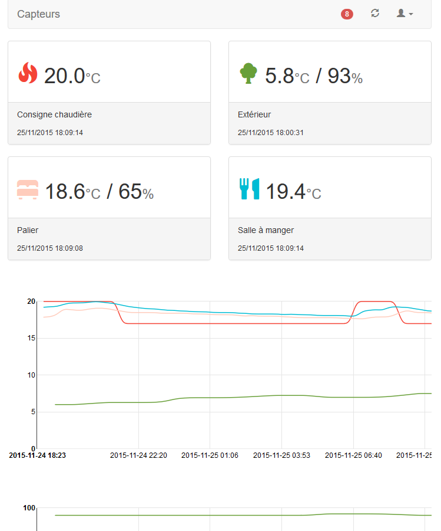

# Firebase based temperature / humidity logger

[](https://www.travis-ci.org/seblucas/firebase-sensor) [](https://coveralls.io/github/seblucas/firebase-sensor?branch=master)

## The idea

The idea came from [Tim Hodson](https://github.com/timhodson/rpi-sensor-station) who [blogged about it](http://timhodson.com/2014/04/rpi-sensor-network-collecting-the-data/) some time ago. So huge thanks to him.

## Firebase

### My goal

My goals were simple:
 * No limit in the number of sensors.
 * Adding a new sensor should only mean to modify a little the database and upload the readings but **never** change a single line of the Web UI.

### Structure

It was kind of hard for me to structure the base as I'm more used to relationnal databases. I ended up doing this :

```
root
  errors
    GUID
      time
      message
  readingCategories
    [hum|lum|temp]
      fractionSize
      label
      order
      unit
  readings
    room_id
      GUID
        time
        temp
        hum
        lum
  rooms
    room_id
      label
      color
      icon
      readings
        temp
        hum
        lum
```

### Security

Firebase Realtime Database access is controlled by Security Rules, not by
whether a page is visible in the UI. Review the supplied rules and their
authorization implications in
[Project Context and Architecture](docs/PROJECT_CONTEXT.md#realtime-database-security-rules).
Confirm that the documented rules match the currently deployed rules before
making security assumptions.

### Todo

I'll probably add the battery level of some sensors, that will mean changing the database structure and the Web UI.

## The Web UI

The interface is built with Vue 3, Vue Router 4 and Vuex 4.
It uses Bootstrap 5.3 for layout and styling, and Bootstrap Icons for icons.
Bootstrap's responsive navigation and dropdown are controlled by Vue; jQuery
and Bootstrap JavaScript are not loaded.

### Room icons in Firebase

The `rooms/{roomId}/icon` value may contain an old Bootstrap 3 Glyphicon name.
The UI converts known legacy names to Bootstrap Icons, so existing Firebase
records do not need to be changed. Both a bare name (`fire`) and its old
`glyphicon-` class (`glyphicon-fire`) are accepted; values containing the old
`glyphicon glyphicon-fire` class pair are accepted too.

| Existing Firebase value | Bootstrap Icons class | Notes |
| --- | --- | --- |
| `bed` / `glyphicon-bed` | `bi bi-lamp` | |
| `tent` / `glyphicon-tent` | `bi bi-house` | Closest available shelter icon |
| `scale` / `glyphicon-scale` | `bi bi-speedometer2` | |
| `cutlery` / `glyphicon-cutlery` | `bi bi-fork-knife` | |
| `fire` / `glyphicon-fire` | `bi bi-fire` | |
| `ice-lolly` / `glyphicon-ice-lolly` | `bi bi-cake2` | |
| `ice-lolly-tasted` / `glyphicon-ice-lolly-tasted` | `bi bi-snow3` | |
| `globe` / `glyphicon-globe` | `bi bi-globe-americas` | |
| `tree-conifer` / `glyphicon-tree-conifer` | `bi bi-tree-fill` | |
| `tree-deciduous` / `glyphicon-tree-deciduous` | `bi bi-tree-fill` | |
| `tree-decidious` / `glyphicon-tree-decidious` | `bi bi-tree-fill` | Supports the existing misspelling |

Other Bootstrap Icons names can be stored directly, with or without the
`bi-` prefix (for example, `alarm` or `bi-alarm`). Unrecognized values using
the old `glyphicon-` prefix, and malformed values, display
`bi bi-question-circle`. To add an alias for an existing database value,
update `src/helper/bootstrapIcon.js` and its unit tests.

The project uses Vite for development/builds and Vitest for unit tests. Run
`yarn serve` to start the development server, `yarn test:unit` to run tests,
`yarn lint` to check the source, and `yarn build` to create the deployable
files in `dist/`.

For contributor and AI-assistant context, see
[Project Context and Architecture](docs/PROJECT_CONTEXT.md).

### How does it look ?



### How do I make this work

Easy :
 * Get latest [release](https://github.com/seblucas/firebase-sensor/releases) and decompress it on your webserver
 * Deploy it to you firebase hosting.
 * Access it.

## Sending values to Firebase

TODO

## Monitoring

I wanted to make sure to be notified if no new data are added to Firebase (because I lost my Internet connection or a crash happenned).

So I created a Cloud function `monitor` to check the time of the last child of most of my reading . I simply compare the node's date with the current date and output a JSON object with the status.

The only thing left is to add a keyword monitor to [UptimeRobot](http://uptimerobot.com/).

## Licence

As stated in the LICENCE file, everything here is licensed under the GPL V2
